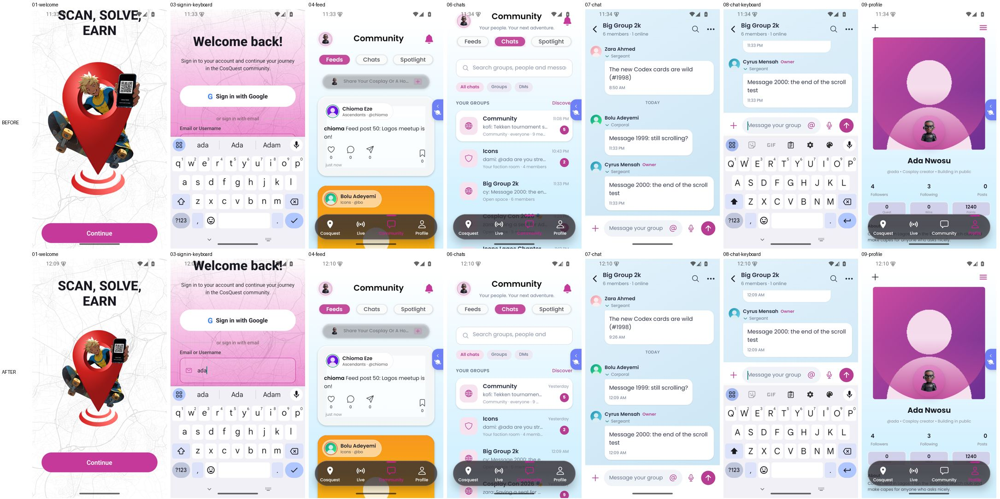
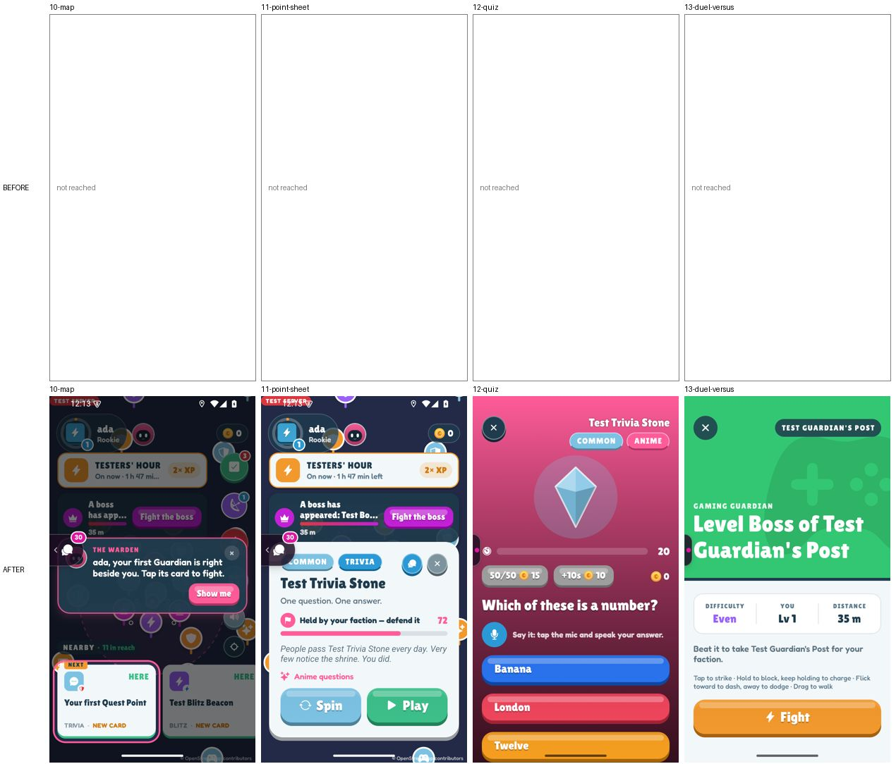
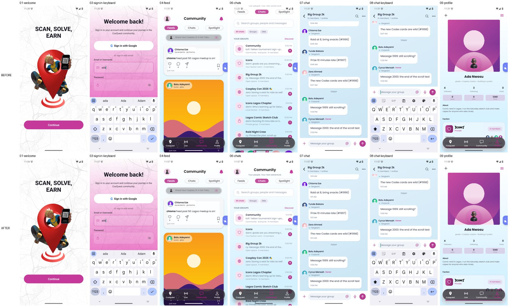
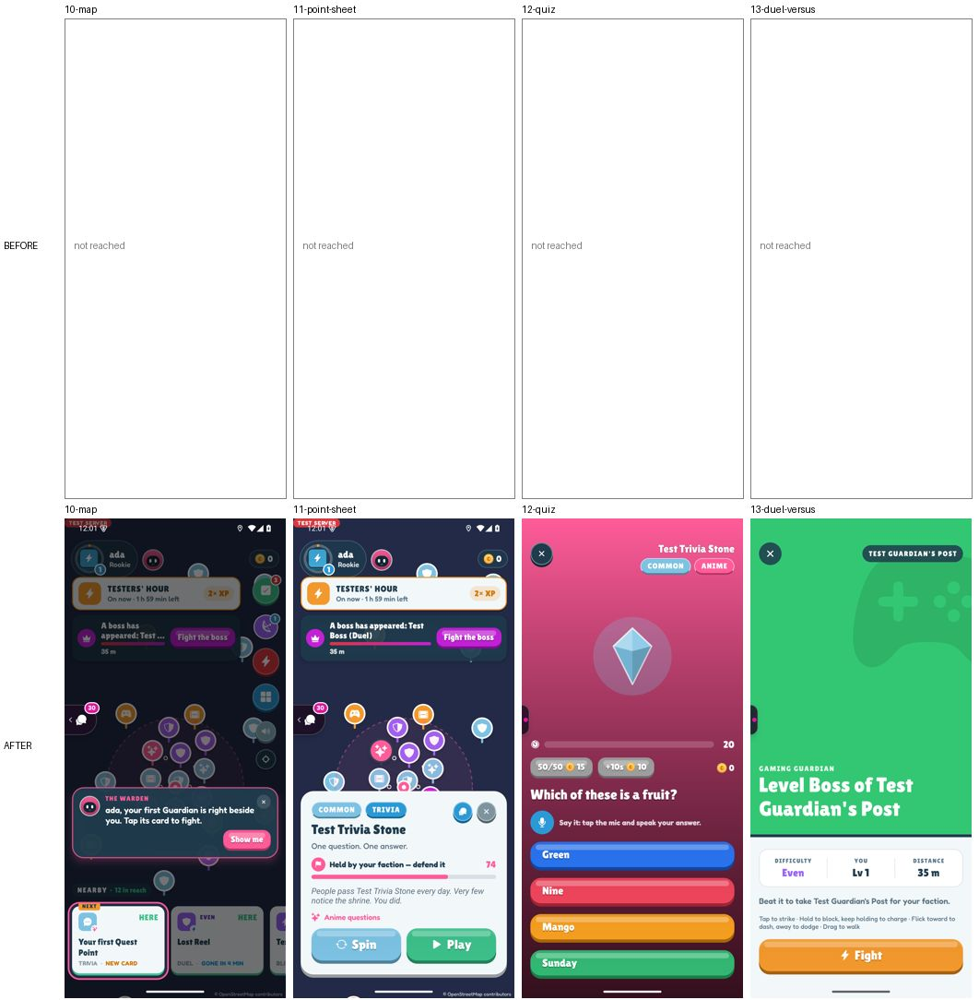
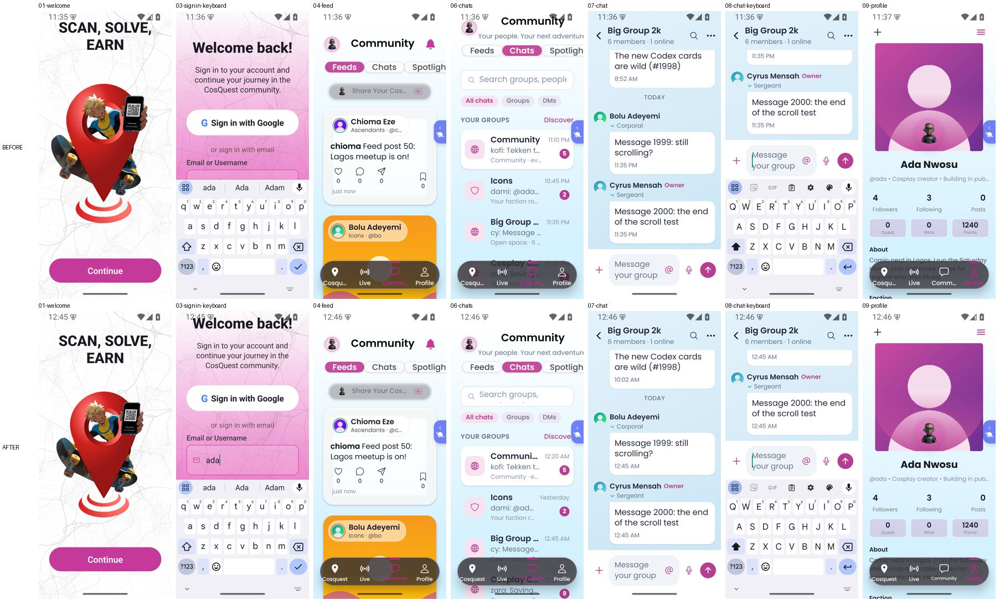
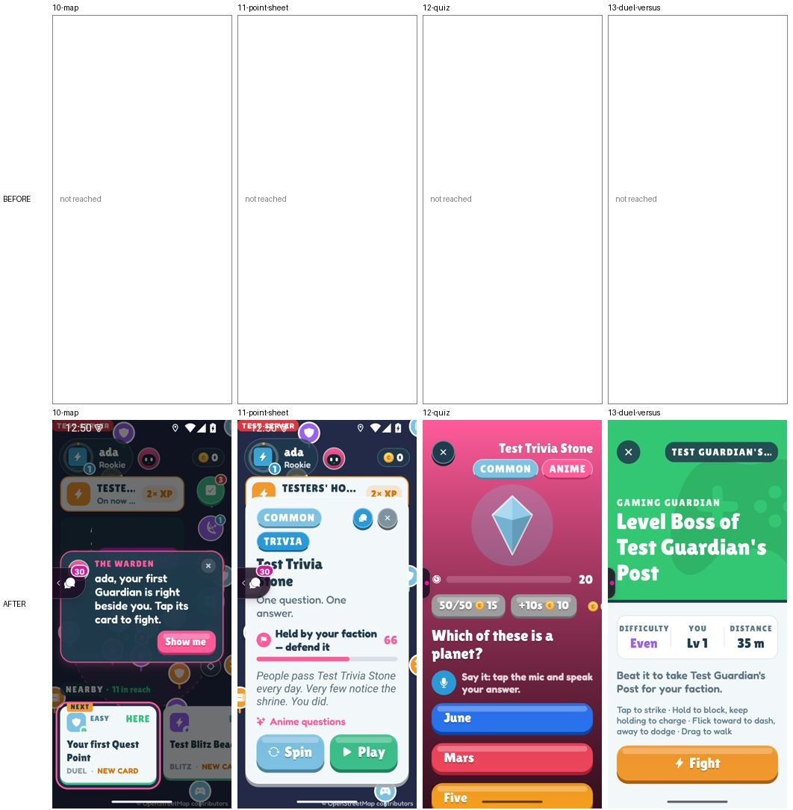

# Polish: before and after, measured (task 058)

Branch `polish-responsive`. "Before" is the merged build (merged-app-sync 6acc955 + one-codebase ab3f41f + the perf markers, APK `cosquest-baseline.apk`); "after" is this branch (`cosquest-after-0355aad.apk` for cold start and feed, `cosquest-after-87e0f1d.apk` for chat and game; the commits between them only touch the feed list window and the Community header). Both are release builds with the JS bundled, built with `EXPO_PUBLIC_PERF_MARKS=1`, against the local chat backend (today's MCJ backend, not the cursor one) and the local game backend.

## How

- Emulator: AVD `cx058`, Android 15, 1440x3120 at 560 dpi, gesture navigation, edge to edge, software GPU (swiftshader) on the farm. Absolute frame numbers are a software renderer's, not a phone's: compare before with after, not with a real device.
- Profiles (`e2e/perf/profile.sh`): small = 720x1280 at 320 dpi (360x640 dp, a 5" phone); large = 1440x3120 at 560 dpi (411x891 dp, tall 20:9); large-a11y = large + font scale 1.3 + display size largest (720 dpi, 320x693 dp); game-ref = 1440x3120 at 420 dpi, for the game only (see "Findings": the before build could not open the map on the other three).
- World: `e2e/reset.sh` with `SEED_PERF=1`: a group "Big Group 2k" with 2,000 messages, 50 feed posts with photos and videos, signed in as ada.
- Measurements (`e2e/perf/measure.py`, numbers in `$OUT/perf-<run>-<profile>.json`, table by `e2e/perf/report.py`):
  - cold: force-stop, `am start -W`; ms from launch to the first feed post on screen (`[perf] mark interactive`, logged by the app), median of 3; and Android's own TotalTime (first frame).
  - feed: 12 flings down and 6 up; UI-thread jank from `dumpsys gfxinfo` (janky frames %, frame-time percentiles), JS frame rate (one `requestAnimationFrame` per JS frame), JS frames over 50 ms, render counts.
  - chat: tap the 2k group in the list three times, ms from the tap to messages on screen; then 10 flings up through its history.
  - map: 20 GPS fixes in 20 s; GameRoot and PointMarker renders.
  - duel: 15 s of a Guardian duel with a tap every 300 ms. quiz: 10 s of a quiz with its clock running.
- Render counts come from `useRenderCount` (test builds only). The duel arena had no counter in the before build: by its code it rendered once per animation frame (a `setSnap` every frame, about 60 a second).

## Results

### Small, 360x640 dp (720x1280 at 320 dpi)

| Measurement | Before | After |
|---|---|---|
| Cold start to first feed post (ms, median of 3) | 2019 | 586 |
| Cold start to first frame, Android TotalTime (ms) | 457 | 427 |
| Feed: UI jank % (12 flings down, 6 up) | 0.77 | 10.42 |
| Feed: frame p90 (ms) | 27 | 65 |
| Feed: JS fps | 56.9 | 49.6 |
| Feed: JS frames over 50 ms | 5 | 35 |
| Feed: PostCard renders while scrolling | 0 | 53 |
| Chat 2k group: open, tap to messages (ms, median of 3) | 52 | 56 |
| Chat 2k group: UI jank % (10 flings up) | 1.33 | 0.22 |
| Chat 2k group: JS fps while scrolling | 60.5 | 60.1 |
| Chat 2k group: Bubble renders while scrolling | 30 | 61 |
| Map, 20 GPS fixes in 20 s: GameRoot renders | - | 5 |
| Map: PointMarker renders | - | 61 |
| Map: JS fps | - | 60.5 |
| Duel 15 s: UI jank % | - | 7.62 |
| Duel: frame p90 (ms) | - | 16 |
| Duel: JS fps | - | 60.1 |
| Duel: JS frames over 50 ms | - | 2 |
| Duel: DuelScreen renders | - | 4 |
| Duel: arena renders (no counter in the before build) | - | 141 |
| Quiz 10 s: JS fps (gfxinfo does not see the quiz's frames) | - | 60.5 |
| Quiz: Encounter renders | - | 0 |

Not measured, before map, duel, quiz: the game's first run could not be finished: 'Show me what's near' was below the screen (fixed in a44b9ec)

### Large, 411x891 dp (1440x3120 at 560 dpi), gesture nav, edge to edge

| Measurement | Before | After |
|---|---|---|
| Cold start to first feed post (ms, median of 3) | 2051 | 531 |
| Cold start to first frame, Android TotalTime (ms) | 497 | 447 |
| Feed: UI jank % (12 flings down, 6 up) | 53.91 | 54.46 |
| Feed: frame p90 (ms) | 61 | 121 |
| Feed: JS fps | 45.9 | 37.6 |
| Feed: JS frames over 50 ms | 9 | 52 |
| Feed: PostCard renders while scrolling | 0 | 74 |
| Chat 2k group: open, tap to messages (ms, median of 3) | 61 | 60 |
| Chat 2k group: UI jank % (10 flings up) | 2.33 | 2.62 |
| Chat 2k group: JS fps while scrolling | 60.4 | 57.8 |
| Chat 2k group: Bubble renders while scrolling | 30 | 100 |
| Map, 20 GPS fixes in 20 s: GameRoot renders | - | 3 |
| Map: PointMarker renders | - | 0 |
| Map: JS fps | - | 60.5 |
| Duel 15 s: UI jank % | - | 8.57 |
| Duel: frame p90 (ms) | - | 16 |
| Duel: JS fps | - | 60.2 |
| Duel: JS frames over 50 ms | - | 1 |
| Duel: DuelScreen renders | - | 2 |
| Duel: arena renders (no counter in the before build) | - | 146 |
| Quiz 10 s: JS fps (gfxinfo does not see the quiz's frames) | - | 60.5 |
| Quiz: Encounter renders | - | 0 |

Not measured, before map, duel, quiz: app crashed opening the map: Canvas: trying to draw too large(158760000bytes) bitmap (fixed in e681ec2)

### Large + font scale 1.3 + display size largest (720 dpi)

| Measurement | Before | After |
|---|---|---|
| Cold start to first feed post (ms, median of 3) | 2111 | 615 |
| Cold start to first frame, Android TotalTime (ms) | 545 | 448 |
| Feed: UI jank % (12 flings down, 6 up) | 54.21 | 47.47 |
| Feed: frame p90 (ms) | 61 | 113 |
| Feed: JS fps | 43.6 | 35.9 |
| Feed: JS frames over 50 ms | 8 | 51 |
| Feed: PostCard renders while scrolling | 0 | 62 |
| Chat 2k group: open, tap to messages (ms, median of 3) | 68 | 59 |
| Chat 2k group: UI jank % (10 flings up) | 2.3 | 1.11 |
| Chat 2k group: JS fps while scrolling | 60.4 | 58.9 |
| Chat 2k group: Bubble renders while scrolling | 30 | 68 |
| Map, 20 GPS fixes in 20 s: GameRoot renders | - | 2 |
| Map: PointMarker renders | - | 0 |
| Map: JS fps | - | 60.5 |
| Duel 15 s: UI jank % | - | 7.59 |
| Duel: frame p90 (ms) | - | 16 |
| Duel: JS fps | - | 59.1 |
| Duel: JS frames over 50 ms | - | 4 |
| Duel: DuelScreen renders | - | 4 |
| Duel: arena renders (no counter in the before build) | - | 146 |
| Quiz 10 s: JS fps (gfxinfo does not see the quiz's frames) | - | 60.6 |
| Quiz: Encounter renders | - | 0 |

Not measured, before map, duel, quiz: app crashed opening the map: Canvas: trying to draw too large(262440000bytes) bitmap (fixed in e681ec2)

### Game reference, 1440x3120 at 420 dpi (the before build's map fits under the bitmap limit here)

| Measurement | Before | After |
|---|---|---|
| Map, 20 GPS fixes in 20 s: GameRoot renders | 9 | 4 |
| Map: PointMarker renders | 0 | 2 |
| Map: JS fps | 60.5 | 60.5 |
| Duel 15 s: UI jank % | 0.91 | 5.43 |
| Duel: frame p90 (ms) | 27 | 18 |
| Duel: JS fps | 60 | 59.6 |
| Duel: JS frames over 50 ms | 2 | 3 |
| Duel: DuelScreen renders | 1 | 4 |
| Duel: arena renders (no counter in the before build) | - | 118 |
| Quiz 10 s: JS fps (gfxinfo does not see the quiz's frames) | 60.6 | 60.5 |
| Quiz: Encounter renders | 0 | 1 |

### Reading the numbers

- **Cold start: about 3.5x faster on every profile** (2.0-2.1 s to 0.53-0.62 s to the first feed post). Most of it is the removed 1.5 s wait and the /home hop (B6); Android's first frame is about the same (the splash is held now, so first frame is the splash, not a blank screen).
- **Duel: the arena re-renders about 8 times a second instead of about 60** (118-146 renders in 15 s; before, one per animation frame by the code). Frame-time p90 on the game reference profile went from 27 to 18 ms. The JS thread kept up at 60 fps in both builds on this 24-core host, so the before build's cost shows less here than it would on a phone; gfxinfo's jank % went up (0.9 to 5.4%) while p50/p90 frame times went down: Reanimated draws more frames of its own, and on a software renderer more of them miss the deadline. Check on a real phone.
- **Map: GameRoot renders 9 to 4 for 20 GPS fixes** (selectors and a 5 s / 5 m watch; game reference). And on high-density screens, before: a crash (finding 1).
- **Quiz:** the clock bar drains on the UI thread and the number re-renders once a second (before: the bar's row re-rendered every 100 ms). gfxinfo does not see the quiz's frames on this emulator (3 frames in 10 s while the bar visibly drains in a recording), so only JS fps is listed: 60 in both.
- **Chat:** opening the 2k group is the same speed (52-68 ms before for 30 messages, 56-60 ms after for 50); scrolling jank is the same or lower. The after build can scroll the whole history (before: only the newest 30), which is why more bubbles render while scrolling.
- **Feed: slower to scroll on this emulator, not faster.** The before feed rendered all 20 posts (the only page it ever loaded) into a ScrollView once, at load; after, a FlatList renders 4 at first and mounts the rest while you scroll, so the first flings do card-building work on the JS thread (JS fps 46 to 38 on large, 57 to 50 on small; small's UI jank 0.8 to 10%). In return: the feed is on screen 1.5 s sooner, later pages load (before: never past post 20), only on-screen videos play (before: every video in the feed played at once), and memory stays flat as the feed grows. Two attempts to win the scroll back are recorded in the history: memoising the cards (200 to 74 renders, kept) and a 21-screen render window (reverted: it caused a crash, see REPORT.md). The next step is FlashList (cells recycled, not rebuilt), which needs PostCard's own state made recycling-safe first (it seeds its edit text and comment and share counts from the post in `useState`, which a recycled cell would keep).


## Findings from the runs (fixed on this branch)

1. **The game map crashed the app on high-density screens.** Opening the map at 560 dpi (large) and 720 dpi (largest display size): `java.lang.RuntimeException: Canvas: trying to draw too large(158760000bytes) bitmap` (262 MB at 720 dpi). react-native-svg draws the 1,800-point board into one bitmap; Android refuses one over 100 MB. The 420 dpi journey emulator stayed just under (89 MB), so the journeys never saw it. Phones at 500+ dpi (Pixel Pro, Galaxy Ultra class) would crash on the map. Fix e681ec2: the ground is drawn at most 4096 px square and scaled up (`features/game/mapRaster.ts`, tested).
2. **A new player on a 360x640 phone could not finish the game's first run.** The Warden's last step ("Show me what's near") was below the bottom edge: the column has fixed minimum heights and no scrolling. Fix a44b9ec: compact sizes under 720 points tall.
3. **Chat history stopped at 30 messages.** Today's backend already pages (`page`, `limit`, newest 30 by default) and the app never asked for more, so a long chat could not be scrolled back (the before chat numbers are for those 30). After: 50 on open, older pages on scroll (both `before` and `page`, so today's backend and the cursor one both work).
4. **The feed showed only the first 20 posts** (page 1, never page 2). After: pages of 20 as you scroll.
5. At the largest text and display size, before: the welcome headline under the status bar, the sign-in field under the keyboard (small and large-a11y), tab labels cut ("Cosqu…", "Comm…"), the third Community pill cut, the Community subtitle cut. After: all fit (shots below).

## Shots

Before (top row) and after (bottom row), same screens: `docs/polish/shots/<profile>-1.jpg` (welcome, sign-in with keyboard, feed, chats, chat, chat with keyboard, profile) and `<profile>-2.jpg` (map, point sheet, quiz, duel). "Not reached" means the before build could not get there on that profile (finding 1 or 2). Full-size PNGs and the recorded tours (videos with a silent audio track): `/opt/cq/tasks/058-cosquest-polish-responsive/out/shots/` and `out/videos/`.

| Profile | Screens | Game |
|---|---|---|
| small |  |  |
| large |  |  |
| large-a11y |  |  |

## Re-run

```sh
. ../rig/env.sh        # ANDROID_HOME, JAVA_HOME, EMU_PORT, OUT (see e2e/README.md)
AVD=cx058 EMU_MEM=2048 e2e/emu.sh up <apk>
e2e/perf/run-profile.sh after large            # tour (recorded) + all measurements
e2e/perf/run-profile.sh after game-ref game    # map, duel, quiz only
python3 e2e/perf/report.py                     # the tables above
```
