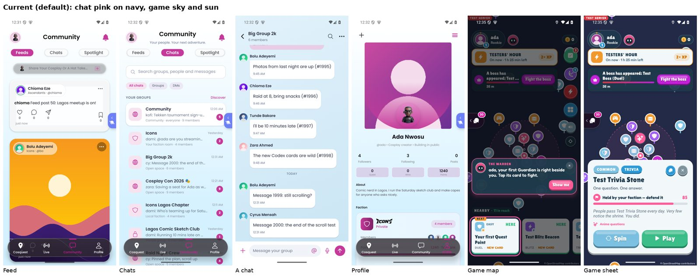
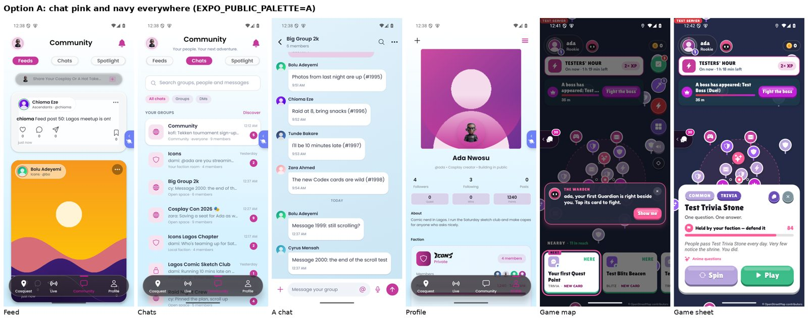
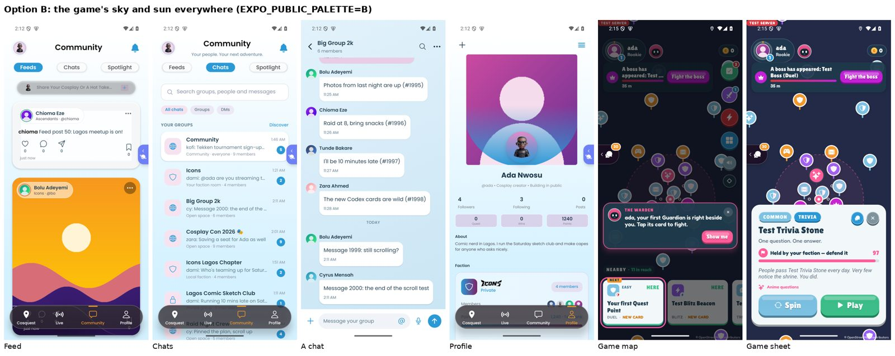
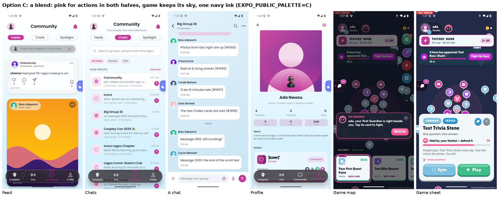
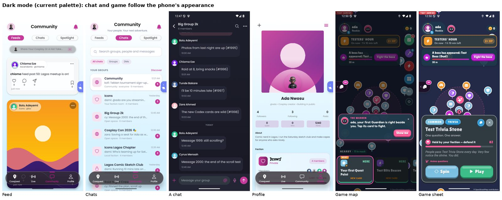

# One palette for chat and game: the board (task 059)

Subomi and Mark choose; nothing here is picked. The default build stays **current** (today's look).

Both halves read one token module (`app/theme/`), so one build-time flag switches the whole app:

```sh
EXPO_PUBLIC_PALETTE=A   # or B, C; unset = current
```

The values are in `app/theme/palettes.ts` (one object per option: a tweak is one line). The six key screens below were taken on the Android emulator (1080x2400) from builds that differ only in that flag (A, B and C at `dc8cf9d`, current at `294a76f`; the commits between them change labels and journeys, not colours), with the same seeded world, at night (the game map lights the town by the hour, so it shows its night board).

## current (default): chat pink on navy, game sky and sun



## A: the chat's pink and navy everywhere

The game's main buttons, highlights and rings turn the brand pink; its sky and ice turn lilac; its ink is the chat's navy. Coins stay gold. The chat is unchanged.



## B: the game's sky and sun everywhere

The chat's brand pink turns the game's deep sky blue (buttons, links, selected tabs, unread dots), its ink the game's navy, its pale screens the game's ice. The game is unchanged.



## C: a blend

Pink stays the one colour for actions, in both halves (the game's main buttons turn pink, coins stay gold); the game keeps its sky; chat and game share one navy ink.



## Dark mode (current palette)

The chat's conversations already followed the phone's appearance (or Settings > Appearance); now the game does too: its sheets go dark by the same role mapping the chat uses, and the map is lit as at night. The feed, the chat list and the profile were light-only before this task and still are (they use fixed light backgrounds, not the chat's themed stylesheets): the next step if dark mode should cover the whole app.



## What changed with no choice made

- One token module for both halves: colours light and dark, the type scale, spacing, radius, elevation and motion durations (`app/theme/tokens.ts`).
- 775 hex colours in 113 chat files now read tokens (`app/scripts/tokenize-colors.js`); the game's GP reads the same palette. The step-1 build (value for value) was screenshot-diffed against the build before it: the only differing pixels were the status-bar clock, timestamps, the game's randomly chosen first point and the notification list caught read vs unread (`docs/polish/cohesion/tokens-diff-*.jpg`: before, after, differing pixels in red).
- The near-duplicate pinks `#B63D91` (41 uses) and `#C34D9C` (29 uses) are now the brand pink `#C5399A`; `#8A8A93` is `#8A8A90` and `#777780` is `#7A7A84`. This is the one deliberate visual change in the current palette.
- Pure white and black stay literals (they never differ between palettes; dark mode maps them by role).
