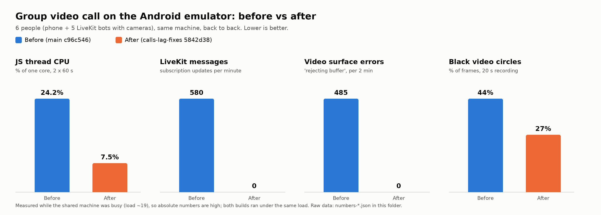
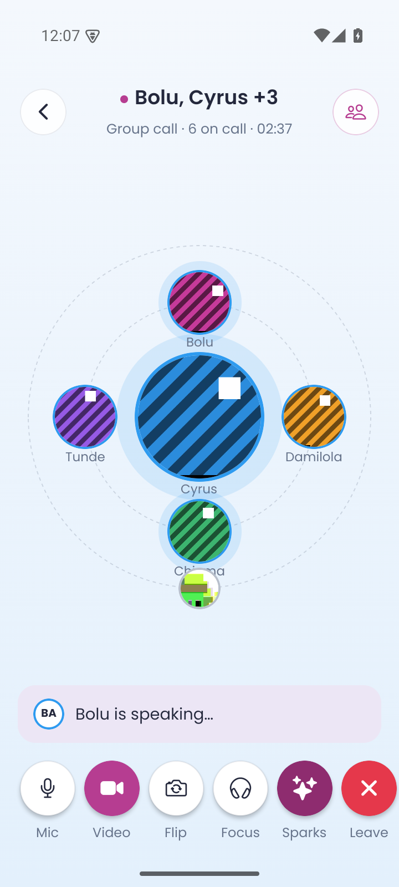
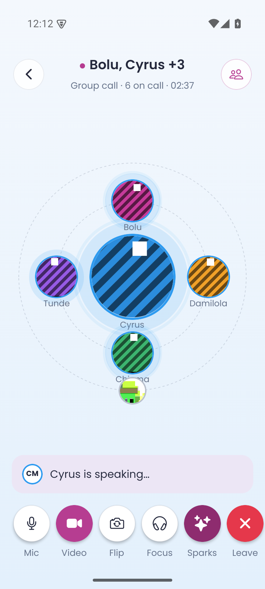

# Group video call lag: evidence

Branch `calls-lag-fixes`. The full write-up is at the bottom of this file (a copy of the PR description): causes, fixes, and how to check on a phone.

## How this was measured
- **The call.** A real 6-person group **video** call on an Android emulator (API 35, x86_64, software GPU), shown in the orbit view.
  - The phone user joins with the emulator camera on.
  - 5 LiveKit bots each send a 640x360 camera and take turns talking in 1-3 s bursts that sometimes overlap.
- **The setup.** A local chat backend and a local LiveKit server; nothing touches production. The app is an x86_64 release APK with the JS bundled in, built from `main` (c96c546) and from this branch.
- **The counts.**
  - LiveKit messages: from the LiveKit server's debug log, only those the phone sent.
  - Surface errors: `BLASTBufferQueue … rejecting buffer` lines in logcat.
  - Black circles: share of frames (5 per second, 20 s recording) with a large pure-black patch in the orbit (`tools/black_frames.py`).

### Same time, same load (the chart above)
The shared machine was busy (load around 19), so the emulator was slow for both builds. They ran back to back under the same conditions.

| | Before (c96c546) | After (5842d38) |
|---|---|---|
| JS thread CPU | 24.2% | 7.5% |
| UI (main) thread CPU | 11.8% | 6.7% |
| App CPU (100% = one core) | 165% | 152% |
| LiveKit subscription messages / min | 580 | 0 |
| Video surface "rejecting buffer" errors / 2 min | 485 | 0 |
| Frames with a black circle | 44% | 27% |

Raw numbers: `numbers-before-3.json`, `numbers-final.json`.

### Quiet machine (earlier runs)
| | Before (2 runs) | After, mid-branch ddee98a (2 runs) | After, final 5842d38 (1 run) |
|---|---|---|---|
| App CPU | 94% | 74% | 81% |
| JS thread | 15.5% | 4.9% | 4.4% |
| LiveKit subscription messages / min | 561 | 0 | 0 |
| "rejecting buffer" / 2 min | ~800 | ~380 | 0 |
| Frames with a black circle | 25% | 17% | 14% |
| Janky frames | 1.1% | 1.3% | 1.4% |

The final run had the machine's load rising, so its CPU figure is the least reliable. Raw numbers: `numbers-before.json`, `numbers-before-2.json`, `numbers-after.json`, `numbers-after-2.json`, `numbers-after-v3.json`.

On a quiet machine the emulator kept about 57 fps in both builds, so frame pacing doesn't separate them. What changed is the work behind each frame. On a phone that is also encoding its own camera and decoding five others, that headroom decides whether the picture stutters.

## Screens
| Before | After |
|---|---|
|  |  |

Same design. After the fix, the "X is speaking" line always names the person in the middle.

12-second clips: [call-before.mp4](call-before.mp4) and [call-after.mp4](call-after.mp4).

## The middle circle (simulation)
`npx tsx scripts/check-orbit-layout.ts` simulates a lively 2-minute, 6-person call: speaker updates every 100 ms, with people talking over each other.
- **Before:** the middle (and the videos in it) changed hands 249 times, as close as 100 ms apart.
- **After:** 82 times, never closer than 0.4 s. The next speaker gets the middle at once when the person in it goes quiet, and someone talking over them has to wait 1.5 s.

## Tried and dropped
- **540p camera.** Cameras without a 540p mode opened twice at 800x600 or 1024x768, and LiveKit logged "encodings mismatch" (it lost layer control). Reverted to the default 720p; dynacast already skips layers nobody watches.
- **Moving circles with a native transform.** Android draws video on its own surface, which doesn't follow transforms, so the videos were left behind as black circles. Reverted to left/top.
- **Video circles jump instead of gliding:** 48% black frames and more jank in one run, though that run was on a loaded machine. Not kept.

## Needs a real phone
- **Heat and CPU over 10 minutes on an iPhone.**
- **The Sparks scribe.** Its model checks compete with the call for the CPU; see "Not in this PR".
- **Brief black while a circle moves.** It may be specific to the emulator's software renderer.

---

## PR description (copy)

## Group video calls: lag and freezes (and the phone getting hot and stuck)

On 22 and 23 October the team reported that group video calls lag and freeze ("it just hung for some time"), and that Emmanuel's iPhone hangs. This PR fixes the causes found in the app. The remaining one is in the Sparks SDK; see "Not in this PR".

Evidence is in `evidence/calls-lag/README.md`: a before/after chart, screenshots, clips and raw numbers from a real 6-person group video call on the Android emulator.

### What was wrong, and what changed

| # | Cause | Fix |
|---|---|---|
| 1 | **The middle circle flipped on every speaker update.** The orbit (group calls with 8 people or fewer) put whoever LiveKit called "speaking" in the middle at once. With people talking over each other, the big and small circles, with live video inside, swapped several times a second. Each swap was a JS-thread spring on left, top, width and height lasting over a second, so the video surfaces were resized every frame. In a simulated lively call the middle changed hands 249 times in 2 minutes, as close as 100 ms apart. | The next speaker takes the middle as soon as the current one is quiet, with a 0.4 s minimum so a flicker can't bounce it. When people talk over each other, the one in the middle keeps it for 1.5 s. The middle goes back to the pinned person only after 1.5 s of quiet. The "X is speaking" line names the person in the middle. Same simulation: 82 hand-overs, never closer than 0.4 s (`npx tsx scripts/check-orbit-layout.ts`). |
| 2 | **Videos went black when circles changed size.** Resizing the live video every frame made Android's video surface drop buffers: about 800 `BLASTBufferQueue … rejecting buffer` errors per 2 minutes on main. | The size changes in one step and the position glides for 320 ms: **0** of those errors. |
| 3 | **The orbit re-rendered twice a second for the whole call**, every video included (the engagement timer). | It re-renders only when the layout changes. `OrbitView` and `OrbitCircle` are memoized. |
| 4 | **The whole call screen re-rendered every second** (the call timer), including the orbit, the Sparks notes, and the hidden Sparks page with the full transcript. | People objects and `renderVideo` stay the same while nothing changes. The Sparks page is built the first time it is opened. Sparks notes and panel are memoized. |
| 5 | **The speaking pulse ran on the JS thread** for every speaker, the whole time they spoke. | It runs on the native driver (opacity and scale only). |
| 6 | **About 560 LiveKit messages a minute from each phone.** The focus-mode and private-call-volume effects ran on every participant update, which happens on every speaker or connection-quality change. Each run called `setSubscribed` on every microphone, and that sends a signalling message every time. | The volume effect runs only when private mode changes or a microphone is added. Focus mode now goes through the subscription manager (`setVoicesMuted`), which owns all subscribes and unsubscribes. That also fixes a voice leaking through focus mode in big calls. Measured: **0** subscription messages a minute. |
| 7 | **Camera lists updated on every speaker and quality event** (the `useTracks` default). | They update on camera events only. |
| 8 | **Video requested at 3x** (`adaptiveStream` "screen" density on iPhones), more pixels than LiveKit's default. | LiveKit's default density: 2x on 3x phones. |
| 9 | **Sparks during calls.** A call answered from a cold start boots Sparks from the call screen, and the ~1 GB model download then ran during the call. While call notes waited for the speech files, every download progress event re-rendered the call screen. | A model download waits until the call ends. A model already on the phone still loads at once, because that is only a file mapping. Phones too old for the model still fetch the speech files. Notes retry only when the model phase changes. |

Voice chats (Community and faction) use the same orbit and had the same patterns, so they get the same fixes. Shared settings are in `components/calls/callMedia.ts`.

The camera stays at LiveKit's default 720p. A 540p capture was tried: cameras without that mode opened twice at odd 4:3 sizes, and LiveKit lost layer control ("encodings mismatch"). dynacast already stops encoding layers nobody watches.

### Measured (Android emulator, 6-person group video call, local LiveKit, 5 bot cameras)
| | main | this branch |
|---|---|---|
| App CPU (100% = one core) | 94% | 73-81% |
| JS thread | 15.5% | 4.4-4.9% |
| LiveKit subscription messages per minute | 561 | 0 |
| Video-surface "rejecting buffer" errors per 2 min | ~800 | 0 |
| Frames with a black circle (20 s recording) | 25% | 14% |

The emulator renders in software and kept about 57 fps in both builds, so frame pacing doesn't separate the two. Some black remains while a circle moves; on the emulator, moving a video surface blanks it briefly. A real phone will show whether that happens there.

### Not in this PR (Sparks SDK, needs Subomi)
- **The on-phone AI competes with the call for the CPU.** The call's "scribe" phone runs a 1.7B-model topic check every 15 s or every 8 lines, plus live summaries. Each check uses all cores but one (`MOTE_RESERVE_CORES=1`). mote has no batched prefill, so a ~200-token prompt keeps those cores busy for seconds (`docs/PERFORMANCE.md`). That is the most likely remaining cause of freezes and heat on that phone.
- **The app can't turn this down without breaking live topics.** `setGameState` pauses the scribe without releasing its lease, and `trivia` mutes transcription.
- **Suggested SDK change:** set `pthread_set_qos_class_self_np(QOS_CLASS_UTILITY, 0)` on the engine worker before `P_BACKGROUND` jobs. `dispatch_apply` inherits it, and iOS then prefers the efficiency cores. Alternatively, cap the matmul threads at 2 while a call transcription session is open.
- The model load itself is not a JS-thread hang. It is an `mmap` on a native background queue, and the SDK's JS layer measured under 1 ms per event.

### How to check on a phone
1. Start a group **video** call with 4 or more people, cameras on, and have two people talk over each other for a minute.
   - The middle should follow whoever is talking, and the "X is speaking" line should match it.
   - Circles shouldn't flicker between people, and videos shouldn't freeze.
2. Flip the camera, then turn video off and on. The picture should come back each time.
3. Keep a 5-person video call going for 10 minutes. The phone should get noticeably less warm than on build 10.
4. Turn Focus on: nobody should be heard, including someone who unmutes while Focus is on. Turn it off: everyone is heard again.
5. Swipe to the Sparks page. It should show live topics and lines (needs Sparks on; not testable on the emulator).
6. Start a private call from the orbit. The group call should go quiet, and someone joining meanwhile should be quiet too.
7. Optional, Xcode Instruments (Time Profiler plus Animation Hitches) during a 5-person call: the JS thread should be mostly idle between speaker changes.

### Checks run
- `npx tsc --noEmit`: clean.
- `npx expo lint`: no new errors. The 12 errors are already on main, in files this PR doesn't touch.
- `npx tsx scripts/check-call-subscriptions.ts`: ok, with a new focus-mode case.
- `npx tsx scripts/check-orbit-layout.ts` (new): ok.

### Already on main, not caused by this PR (seen while testing)
- In the orbit, your own small circle covers the bottom person's name.
- In 1:1 calls, the minimize chevron covers "‹ Call" on the Sparks page (PR #12 fixes this), and the End button sits at the right edge.

### PR #12 (`ios-build11-fixes`)
This PR and #12 conflict in one place: the `SparksCallPanel` element in `CallSession.tsx`. Keep the `sparksSeen ? (...) : null` wrapper and add #12's `clearMinimize={!call.isGroup}` inside it. A branch with both merged is pushed as `calls-lag-fixes-build11`.
